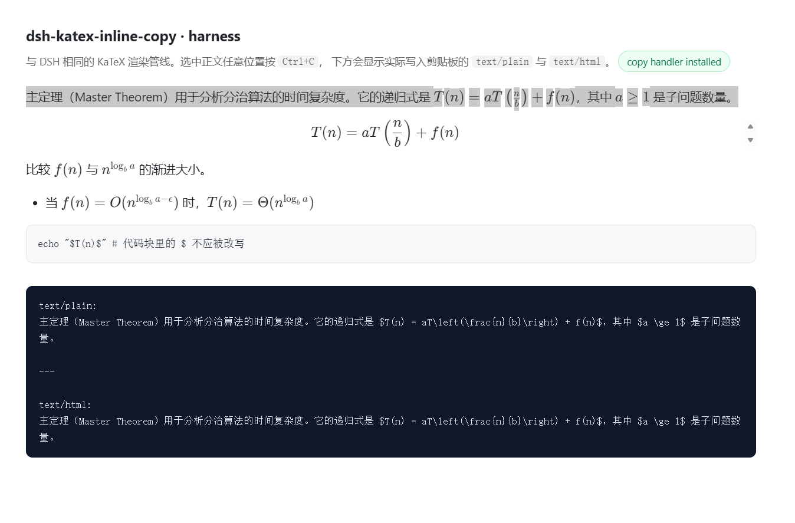

# dsh-katex-inline-copy

在 DeepSeek Harness 的对话里复制带公式的内容时，剪贴板里拿到的是
`$...$` / `$$...$$` 的 LaTeX 源码，而不是 KaTeX 渲染后的一堆 `span`。



效果与 Gemini Web 的「选中复制公式不崩」一致：

```text
比较 $f(n)$ 与 $n^{\log_b a}$ 的渐进大小。

$$T(n) = aT\left(\frac{n}{b}\right) + f(n)$$
```

## 安装

```powershell
# 从 GitHub 直接安装
dsh plugin add github:Takeoff0518/dsh-katex-inline-copy

# 或者在 设置 → 插件 里按绝对路径安装
```

安装后立即生效，无需重启。

## 行为

| 操作 | 结果 |
| --- | --- |
| 选中含行内公式的正文 | 公式变成 `$...$`，正文原样 |
| 选中块级公式 | 变成 `$$...$$`，独占一行 |
| 只选中公式里的半个字符 | 自动补成整条公式 |
| 复制代码块 | 完全不变（DSH 自己的复制按钮照旧） |
| 复制输入框里的文字 | 完全不变 |
| `Ctrl+Shift+V` | 得到同样的 LaTeX 文本 |

## 原理

DSH 用 KaTeX 渲染公式（`katex.renderToString(tex, { displayMode })`），所以每个公式在
DOM 里长这样：

```html
<span class="katex">
  <span class="katex-mathml">
    <math><semantics><mrow>…</mrow>
      <annotation encoding="application/x-tex">T(n)=aT\left(\frac{n}{b}\right)+f(n)</annotation>
    </semantics></math>
  </span>
  <span class="katex-html" aria-hidden="true">…</span>
</span>
```

TeX 源码一直在 `annotation` 里——这也是不需要额外 `data-math` 属性的原因。

插件在 `document` 上挂一个捕获阶段的 `copy` 监听：

1. 有选区、不在输入框/代码块里；
2. 选区确实碰到 `.katex`（用 `range.intersectsNode` 判断）；
3. 把选区端点扩到整条公式（对应 Gemini 的 `Mpk`）；
4. `cloneContents()` 后，把每个公式节点替换成 `$…$` / `$$…$$` 文本节点；
5. `preventDefault()`，把 `text/plain` + `text/html` 写进 `event.clipboardData`。

第 5 步用同步 `clipboardData.setData`：它在 copy 事件里是权威写入，不受焦点和权限
影响（Gemini 因为要带内联样式才走了异步 `ClipboardItem`，这里不需要）。只有浏览器
没提供 `clipboardData` 时才退回 `navigator.clipboard.write`。

原始消息 DOM 全程不被修改。

## 开关

默认开启。想临时关掉（浏览器控制台执行）：

```js
localStorage.setItem('dsh-katex-inline-copy.enabled', 'off')
```

恢复：

```js
localStorage.removeItem('dsh-katex-inline-copy.enabled')
```

## 限制

- 只处理 KaTeX 渲染出来的公式（`.katex`）；`katex-error` 会保持原样；
- 不做 MathML→图片、也不做 Word/飞书专用格式；
- 公式围栏固定为 `$` / `$$`，可通过改 `src/math.ts` 的 `wrapTex` 换风格；
- 依赖 KaTeX 在 DOM 里保留 `<annotation encoding="application/x-tex">`。

## 开发

```powershell
npm install
npm test          # 21 个用例（node:test + jsdom + 真实 KaTeX）
npm run typecheck
npm run build     # src/ → lib/client.js，并构建 harness
npm run serve     # http://127.0.0.1:8123/tools/harness/
```

`tools/harness/` 是一个用同一套渲染管线、同一份复制代码的本地页面，选中文字按
Ctrl+C 就能看到实际写入剪贴板的内容，不用重启 DSH。

```
src/math.ts       选区 ↔ 公式节点、TeX 提取、$ 包裹
src/transform.ts  克隆 → 替换 → { html, text }
src/install.ts    copy 监听、选区扩展、写剪贴板、兜底
src/index.ts      插件入口（ModuleLoader factory）
lib/client.js     构建产物（提交进仓库，供按路径安装）
```

## 卸载

在 设置 → 插件 里移除 `dsh-katex-inline-copy`，或调用 `plugin_manager` 的
`remove_bundle`。卸载后复制行为立即回到原生。
